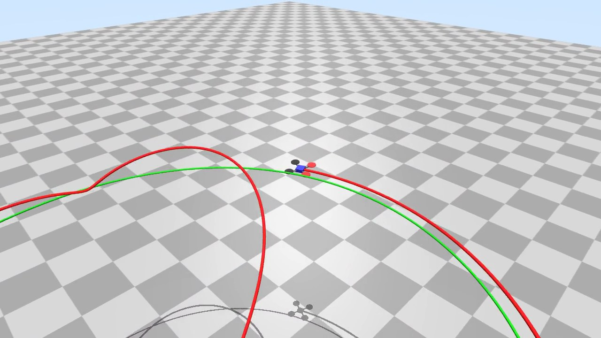
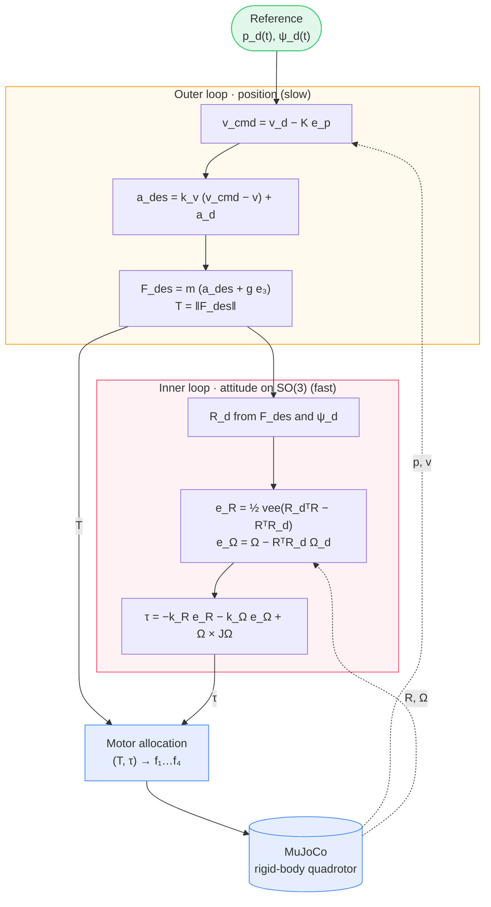
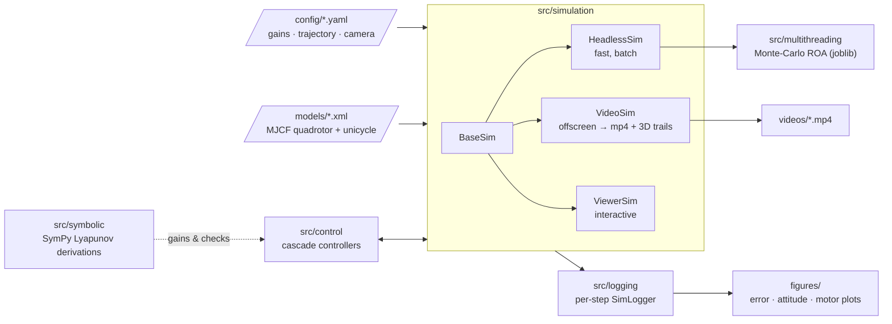
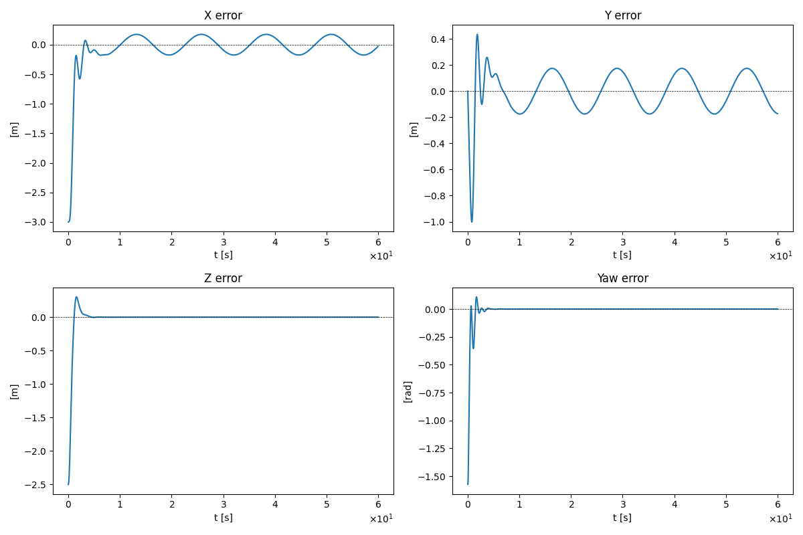
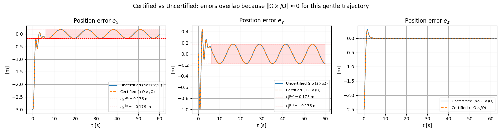

<div align="center">



<br/>


-000000?logo=apple&logoColor=white)

**A quadrotor that follows a 3D circle using a geometric cascade controller on SO(3).**<br/>
Designed on paper, derived in SymPy, and flown in MuJoCo.

[Quickstart](#-quickstart) · [Architecture](#-control-architecture) · [Results](#-results) · [Stability: what is and isn't claimed](#-stability-what-is-and-isnt-claimed) · [Report (PDF)](Report_Robo%20Motion%20Control_De%20Matteis-1.pdf)

</div>

---

## ✨ Highlights

- **Geometric cascade control** following Lee, Leok & McClamroch (2010). The attitude error is defined on SO(3) itself, so there are no Euler-angle singularities.
- **Gyroscopic cancellation** `Ω × JΩ`. `J` is read straight from the MuJoCo model, so the cancellation matches the simulated physics exactly.
- **The Lyapunov derivation is code.** SymPy computes the time derivative `V̇` of the Lyapunov function, and the code fails loudly if a change breaks the derivation.
- **Modular simulation stack:** headless, video and interactive viewer wrappers share one `BaseSim`. Logging happens at every step. Simulation FPS is decoupled from video FPS.
- **Tuned from YAML:** gains, trajectory, camera and Monte-Carlo region-of-attraction sampling are all set in config files, with no code edits.

<p align="center">
  <br/>
  <sub><b>Real MuJoCo render.</b> <span>🟢 prescribed trajectory · 🔴 trajectory actually followed. The drone takes off from near the ground and converges onto the circle (R = 3 m, z = 3 m, ω = 0.5 rad/s).</span></sub>
</p>

---

## 🧭 Control architecture

The UAV is underactuated: it has 6 degrees of freedom but only 4 motors, so it must **tilt in order to translate**. The controller exploits time-scale separation. A slow outer loop decides *where to push*. A fast inner loop rotates the body so that the thrust points that way.



The only difference between the two controllers is the torque law:

| Controller | Torque law | Class |
|---|---|---|
| Uncertified | `τ = −k_R e_R − k_Ω e_Ω` | [`CascadeController`](mcav_project/src/control/cascade_controller.py) |
| Certified | `τ = −k_R e_R − k_Ω e_Ω + Ω × JΩ` | [`CertifiedCascadeController`](mcav_project/src/control/certified_cascade_controller.py) |

---

## 🧱 Software pipeline



---

## 📈 Results

Circular reference with R = 3 m at z = 3 m, ω = 0.5 rad/s, simulated for 60 s at Δt = 2 ms. The gains are in [`config/quadcopter_certified_circle.yaml`](mcav_project/config/quadcopter_certified_circle.yaml).

<p align="center">
  
</p>

- **Altitude and yaw** errors converge to zero within about 5 s.
- **Horizontal** (x, y) errors settle into a **bounded oscillation of about ±0.18 m** at the orbit frequency. That is roughly 6 % of the radius. In the frame rotating with the reference it is a constant lag, so the drone traces the circle but lags slightly behind the moving reference point.

<p align="center">
  
</p>

- **Certified vs uncertified:** on this gentle trajectory the two error curves lie on top of each other, because `‖Ω × JΩ‖ ≈ 0`. The gyroscopic term matters for the *proof*, not for this particular flight.

---

## 🔬 Stability: what is and isn't claimed

| | Statement | Basis |
|---|---|---|
| ✅ **Shown** | With the kinematic model (`ṗ = v_cmd`), `V₁ = ½‖e_p‖²` gives `V̇₁ = −e_pᵀ K e_p`, so the position error decays exponentially | Direct derivation ([`src/symbolic`](mcav_project/src/symbolic/)) |
| 📚 **From the literature** | The SO(3) attitude loop with the `Ω × JΩ` term is exponentially stable for attitude errors `Ψ < 2`, and almost-globally attractive | Lee et al. (2010) |
| 👀 **Observed** | Altitude and yaw errors converge. The x/y error stays bounded within ±0.18 m but does not go to zero | MuJoCo simulation, figures above |
| ⚠️ **Assumed** | No motor saturation (`saturate: false`), and the inner loop is fast compared with the outer loop | Explicit modelling assumptions |

> [!NOTE]
> No continuous feedback law can make an attitude on SO(3) *globally* asymptotically stable. This is a topological obstruction. So no claim of global stability of the full cascade is made here. The best achievable result is almost-global stability.

---

## 🚀 Quickstart

```bash
git clone https://github.com/ViDem02/MCAV.git
cd MCAV/mcav_project
uv sync                 # creates .venv with the pinned dependencies
uv run jupyter lab      # then open notebooks/final.ipynb
```

`final.ipynb` runs the symbolic derivations, both controllers, the plots and the video rendering from start to finish. Videos are written to `mcav_project/videos/` and figures to `mcav_project/figures/`.

<details>
<summary>Without <code>uv</code></summary>

```bash
cd mcav_project
source .venv/bin/activate
jupyter lab
```
</details>

---

## 🗂️ Repository layout

```text
mcav_project/
├── config/          YAML experiments (gains, trajectory, camera, ROA sampling)
├── models/          MuJoCo models: quadcopter (kinematic + dynamic), unicycle
├── notebooks/       final.ipynb + exploratory notebooks (unicycle, path following, …)
├── src/
│   ├── control/         CascadeController, CertifiedCascadeController, path following
│   ├── simulation/      BaseSim → Headless / Video / Viewer
│   ├── symbolic/        SymPy Lyapunov derivations
│   ├── multithreading/  Monte-Carlo region-of-attraction (joblib)
│   ├── logging/         per-step SimLogger
│   └── utils/           config loading, plotting, animations
└── doc.md           theory notes (Lyapunov, LaSalle, SO(3) attitude error)
```

---

## 📚 Reference

T. Lee, M. Leok, N. H. McClamroch, *"Geometric tracking control of a quadrotor UAV on SE(3)"*, IEEE CDC 2010.

<sub>Built for the seminar *Motion Control of Autonomous Robotic Vehicles*, University of Trento · Victor Gabriele De Matteis</sub>
